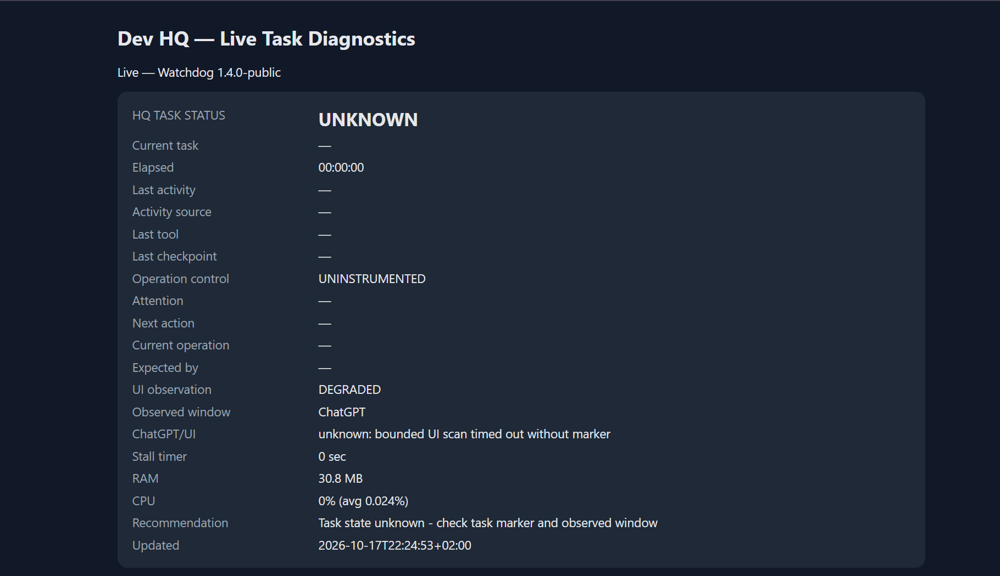
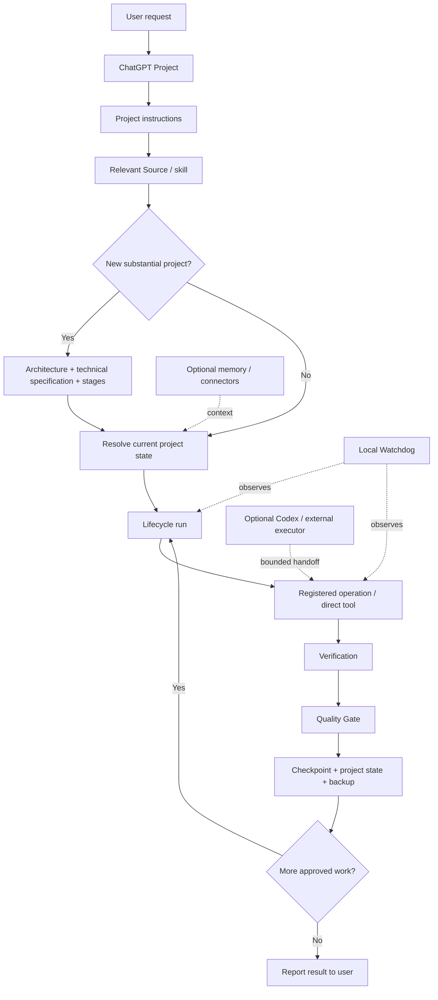

# Dev HQ

**A development control plane for ChatGPT.**

Dev HQ turns long, tool-heavy ChatGPT development sessions into a staged, recoverable workflow with explicit architecture, task state, checkpoints, operation tracking, quality gates and a local watchdog.

**ChatGPT-first. Codex optional. External coding agents are not required for the core workflow.**

[](LICENSE)

## Why Dev HQ exists

Chat-based development is powerful, but longer projects tend to fail in predictable ways:

- context gets lost between chats;
- a tool call hangs and the whole workflow stalls;
- a retry repeats an unknown side effect;
- "the process is alive" gets mistaken for real progress;
- implementation starts before architecture and acceptance criteria are clear;
- testing happens too late;
- the assistant finishes work but never reports what actually changed.

Dev HQ adds a durable operating layer around the chat so the workflow can **plan, execute, verify, recover and continue** instead of relying on one uninterrupted conversation.

## What you get

- **Architecture-first project start** — architecture, full technical specification, stages, tests and decision points before implementation.
- **Stage-by-stage execution** — bounded change → verification → checkpoint → next stage.
- **Durable lifecycle runs** — task state survives interrupted chats and model/session limits.
- **Operation control** — long-running tool calls get identity, deadlines and evidence expectations.
- **Recovery without blind retries** — unresolved side effects are inspected before re-execution.
- **Quality Gate 2.0** — Git/diff checks, secret detection, tests/lint/build and acceptance verification.
- **Local Watchdog** — shows task state, operation state, stalls, resource usage and recovery guidance.
- **Verified local backups** — checkpoint archives with manifests and SHA-256 verification.
- **Reusable skills and Sources** — compact operational rules instead of one giant instruction file.
- **Public/private separation** — reusable HQ logic stays in Git; environment, credentials and real project state stay local.

## Watchdog

The Watchdog is a lightweight local observer. It does not execute your project for you; it makes long work visible and helps detect when the task state, operation state or UI observation becomes stale.



The screenshot above is from the real local Watchdog UI. `UNKNOWN` and `DEGRADED` are valid diagnostic states: Dev HQ prefers uncertainty over pretending that progress was verified.

## Architecture



## 5-minute Quick Start

### 1. Clone the repository

Clone this repository with GitHub's **Code** button or your preferred Git client.

### 2. Choose your projects root

Core scripts use `~/Projects` by default. To override it:

```powershell
$env:DEV_HQ_PROJECTS_ROOT = "$HOME\Projects"
```

Optional settings are documented in `.env.example`. Dev HQ does **not** automatically load `.env` files.

### 3. Create a ChatGPT Project

Create a normal ChatGPT Project, then:

1. copy the contents of `CHATGPT_PROJECT_INSTRUCTIONS.md` into the Project instructions;
2. add the six files from `sources/` as Project Sources;
3. connect only the tools you actually use.

No Codex setup is required for the core workflow.

### 4. Create local private state

Copy only the templates you need and remove `.example` from the local copies, for example:

```text
ENVIRONMENT.example.md       -> ENVIRONMENT.md
PROJECTS_REGISTRY.example.md -> PROJECTS_REGISTRY.md
PROJECT_STATE.example.md     -> PROJECT_STATE.md
```

Those local files are ignored by Git.

### 5. Start the Watchdog (optional)

Windows:

```powershell
powershell -ExecutionPolicy Bypass -File .\scripts\start-hq.ps1
```

Then open:

```text
http://127.0.0.1:32110/hq-status
```

### 6. Give Dev HQ a real task

A good first prompt is:

> I want to build a new project from scratch. First create the full architecture, technical specification, stages, tests and acceptance criteria. Do not start implementation until the plan is approved.

After approval, Dev HQ follows the staged lifecycle automatically.

## The development loop

```text
idea
  -> architecture + technical specification
  -> approved stages
  -> lifecycle run
  -> bounded implementation
  -> verification
  -> quality gate
  -> checkpoint/state
  -> next stage
  -> final report
```

For potentially long or failure-prone calls, the operation is registered before execution. A live PID, a heartbeat or a reachable service is **not** treated as proof of progress.

## Recovery model

When a chat is interrupted, a tool times out or a model limit is reached, Dev HQ does not simply start over.

It recovers the same saved run, inspects unresolved operations and artifacts read-only, determines whether the previous action completed, failed or has an unknown outcome, and only then continues.

This is especially important for actions with side effects such as publishing, external messages, production changes and workflow execution.

## ChatGPT Plus without Codex

Dev HQ is designed around normal ChatGPT chat plus connected tools. Codex or another coding executor can be added for a bounded task, but it is not required to run the lifecycle, maintain project state, inspect files, execute tests or coordinate development.

See the full walkthrough: **[Demo case — ChatGPT Plus without Codex](docs/DEMO_CASE_CHATGPT_PLUS.md)**.

## Repository map

| Path | Purpose |
|---|---|
| `CHATGPT_PROJECT_INSTRUCTIONS.md` | Compact top-level behavior for the ChatGPT Project |
| `sources/` | Six focused operational Sources |
| `scripts/task_lifecycle.py` | Durable task lifecycle runner |
| `scripts/operation_control.py` | Operation registry and side-effect protection |
| `scripts/hq_watchdog.py` | Local status observer and web UI |
| `scripts/quality_gate.py` | Verification and release-quality checks |
| `scripts/backup_project.py` | Verified project checkpoints |
| `scripts/public_release_audit.py` | Secret/privacy scan before public release |
| `skills/` | Optional tool-specific instructions |
| `templates/` | Reusable project/ADR/quality templates |
| `*.example.md` | Safe templates for local private state |

## Public vs private state

The repository intentionally excludes real machine/account/project state.

Keep these local:

- credentials, tokens, cookies and private keys;
- environment inventory and private endpoints;
- current project registry and project state;
- runtime logs and lifecycle artifacts;
- generated handoffs and records;
- personal model/tool preferences.

The `.gitignore` and public release audit are designed around that boundary.

## Security and release checks

Before publishing changes:

```powershell
python scripts\public_release_audit.py --root .
python -m pytest -q
```

For code/config tasks inside a managed project, Dev HQ also uses its own Quality Gate 2.0 before declaring technical completion.

A secret that has ever been committed should be rotated even if it is later removed from the working tree.

## What Dev HQ is not

Dev HQ is **not**:

- an autonomous background coding agent;
- a replacement for tests or code review;
- a promise that a stopped ChatGPT turn will resume by itself;
- an automatic retry engine for unknown side effects;
- a reason to put credentials or production state into the repository.

The Watchdog observes and diagnoses. The chat remains the decision and execution layer.

## Current platform notes

- Core lifecycle/quality scripts are Python-based.
- The current local Watchdog integration is Windows-first.
- External connectors are optional; use only the tools available in your own ChatGPT environment.
- Model names are intentionally not hard-coded into the public workflow.

## License

MIT — see [LICENSE](LICENSE).
